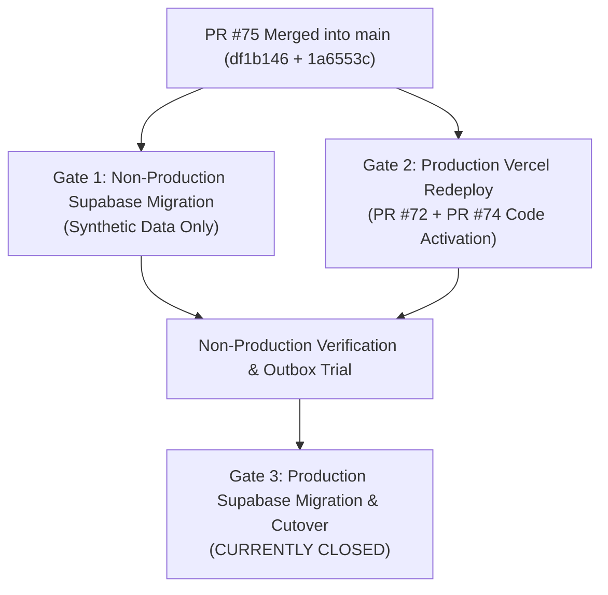

# Owner Approval Gate (`OWNER_APPROVAL_GATE.md`)
### Formal Sign-Off Record for Staging Migration, Production Redeploy, and Production Cutover

> [!IMPORTANT]
> **Mandatory Security Requirement**
> No engineer, agent, or automated CI/CD pipeline may execute remote database migrations or production deployments without an explicit, recorded owner sign-off statement matching the exact required text in this document.

---

## Gate 1: Non-Production Supabase Migration

**Purpose**: Authorizes applying the core schema foundation to a designated non-production/isolated Supabase environment (e.g., Staging) using synthetic data only.

### Status: `[ PENDING OWNER SIGN-OFF ]`

### Required Owner Approval Statement
> **“I approve applying migration `20261012170000_core_schema_foundation.sql` from commit `1a6553ccab166670f4846c1e3a44493ed3ae66c2` to the named non-production Supabase project using synthetic data only.”**

### Execution Requirements & Sign-Off Record

| Field | Required Value / Confirmation | Operator / Owner Entry |
| :--- | :--- | :--- |
| **Named Non-Production Project** | Distinct Staging project ref (e.g. `childcare3-staging`) | *[To be provided by Owner]* |
| **Project URL & Ref Verified** | Confirmed NOT production Supabase project | `[ ] Verified` |
| **Execution Window** | Agreed date and time range (UTC/IST) | *[To be defined upon approval]* |
| **Designated Operator** | Name of authorized engineer executing runbook | *[To be defined upon approval]* |
| **Backup / Snapshot Confirmed** | Staging database snapshot taken prior to migration | `[ ] Confirmed` |
| **Rollback Owner** | Lead Architect responsible for executing rollback | *[To be defined upon approval]* |
| **Real Beneficiary Data Prohibition** | Confirmed synthetic test seed data only (`SYNTH-*`) | `[X] Confirmed Prohibition` |
| **Owner Signature / Date** | Digital sign-off in issue or PR comment | *[Pending]* |

---

## Gate 2: Production Vercel Redeployment

**Purpose**: Authorizes redeploying the live production Vercel alias `https://childcare-support-phase-3.vercel.app` from `main` to replace the stale pre-PR-#74 deployment.

### Status: `[ PENDING OWNER SIGN-OFF ]`

### Required Owner Approval Statement
> **“I approve redeploying `main` at commit `df1b1460aa2833e7a47929de28792c7099b54317` to the production Vercel alias `https://childcare-support-phase-3.vercel.app`.”**

### Execution Requirements & Sign-Off Record

| Field | Required Value / Confirmation | Operator / Owner Entry |
| :--- | :--- | :--- |
| **Deployment Source Commit** | `df1b1460aa2833e7a47929de28792c7099b54317` (or `1a6553ccab166670f4846c1e3a44493ed3ae66c2`) | `[X] Verified on main` |
| **Target Production Alias** | `https://childcare-support-phase-3.vercel.app` | `[X] Confirmed` |
| **Deployment Window** | Low-traffic deployment window (UTC/IST) | *[To be defined upon approval]* |
| **Designated Operator** | Name of authorized engineer executing deployment | *[To be defined upon approval]* |
| **Rotated Secrets Verified** | Rotated `WEBHOOK_SECRET` (`envId: trhzCRYcI1ylVaZW`) confirmed | `[ ] Confirmed in Vercel` |
| **Zero Auto-Migration Confirmed** | Confirmed no build script runs database migrations | `[X] Confirmed (vercel.json / package.json)` |
| **Rollback Owner** | Lead Architect responsible for instant alias rollback | *[To be defined upon approval]* |
| **Owner Signature / Date** | Digital sign-off in issue or PR comment | *[Pending]* |

---

## Gate 3: Production Supabase Migration & Real-Data Cutover

**Purpose**: Future authorization for applying schema to the production Supabase database, cutover from Google Sheets primary to Supabase primary, and data migration.

### Status: `[ CLOSED — DO NOT PROCEED ]`

> [!CAUTION]
> **Mandatory Policy**
> **This gate remains closed. Do not apply the schema to production, import real beneficiary data, or begin production cutover until a separate, explicit owner approval is recorded after successful non-production validation.**

### Prerequisites to Open Gate 3 in the Future:
1. Gate 1 (Non-Production Supabase Migration) fully executed and verified against all 16 post-migration checklist items.
2. Gate 2 (Production Vercel Redeployment) fully deployed and verified with `df1b1460aa2833e7a47929de28792c7099b54317`.
3. Complete end-to-end synthetic staging trial of dual-write outbox worker syncing between Supabase and Google Sheets `Child_Nutrition` mirror.
4. Production database backup and migration rollback rehearsal completed.
5. DPDP Act compliance sign-off on PII masking and Tigris private storage isolation.
6. Formal separate written owner approval recorded in a dedicated cutover issue.

---

## Summary of Gate Dependencies

