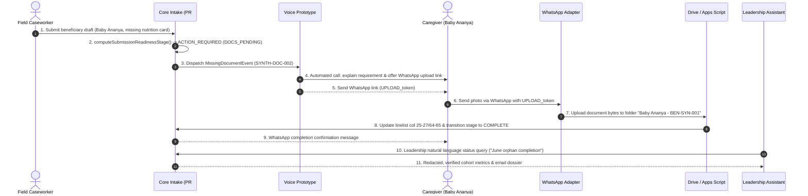

# Cross-Thread Integration Handoff & Ownership Ledger
**Location**: `docs/CROSS_THREAD_INTEGRATION_HANDOFF.md`
**Role**: Integration Coordinator
**Last Updated**: 2026-10-15T21:52:00+05:30
**Baseline**: Remote `main` at `631afd38c443403b83bad8300a3701ea258c6269`

---

## 1. Domain Ownership Register

| Domain | Owner Thread | Directory / Worktree | Branch Name | Full Commit SHA | Interface Contract | Verified Local Result | Blocker / Dependency | Immediate Next Action |
| :--- | :--- | :--- | :--- | :--- | :--- | :--- | :--- | :--- |
| **Submission Intake** | Thread-Readiness (PR #82) & Core Main | `Childcare-PR82` | `feat/staged-readiness-bank-queue` | `b6de72543b24ed20ccf5acc35b8c78556f6d1e15` | `POST /api/submissions`, `computeSubmissionReadinessStage()`, `BankDetailsEntryModal` | 751 tests pass; stage calculation, leading zeros in bank accounts, offline outbox sync verified | Needs PR #82 merge authorization; depends on core canonical schema | Keep isolated in PR #82; await release candidate inclusion approval |
| **WhatsApp Transport / Ingestion** | Thread-WhatsApp / Catalyst | `Childcare-Catalyst-Adapter` | `feat/catalyst-whatsapp-adapter` | `51d52b04d12ddc5b36125a1d5288b894d93ac04d` | `POST /api/integrations/whatsapp/webhook`, `whatsappWebhookParser.ts` | 413 HTTP payload guard, constant-time HMAC-SHA256, PII redaction pass 100% | Meta App in Development Mode; endpoint is strictly receive-only event sink; **no media download worker** | Retain receive-only boundary; specify media byte download contract before activation |
| **Reporting (Conversational)** | Thread-Leadership-Assistant | `Childcare-Leadership-Assistant` | `feat/leadership-reporting-assistant` | `b690e40f0dfdfd32ad93b263a4de74b41522f9d3` | `intent-router.ts`, `metrics-calculator.ts`, `reporting-agent.ts` | June single-orphan scenario, intent parsing, 500-record benchmark eval pass | Disconnected from live Sheet; uses local synthetic dataset | Bind to authoritative `reportingEmailDelivery.ts` read adapter |
| **Apps Script & Reporting Email** | Thread-Backend-Hardening (Current) | `Childcare-Support-Phase-3(1)` | `feat/staging-destination-hardening` | `6ce5ee608b3fa21a594edb9a5c70103a34e13790` | `gas/Code.js`, `gas/ReportingEmailService.js`, `reportingEmailContract.ts`, `reportingEmailDelivery.ts` | 54 tests pass (14 staging guard, 26 reporting email, 14 behavioral); fail-closed destination isolation verified | Staging infrastructure not provisioned; MailApp daily quota limited (100k Workspace / 20k Consumer) | Create staging environment template and synthetic linelist fixtures |
| **Voice Calling Agent** | Thread-Voice-Prototype | `Childcare-Voice-Prototype` | `prototype/calling-agent-voice-harness` | `b2fc5a1b497e09f8f075ca8fcb310bb9e6dabfce` | `POST /api/staff/voice/token`, LiveKit Agent Worker, `mock-tools.ts` | Mock token issuing, room reservation lifecycle, session cleanup, synthetic missing-doc event pass | In-memory synthetic store only; does not connect to live backend or Meta API | Maintain disposable harness; align handoff token schema with WhatsApp parser |
| **Editorial Landing** | Thread-Landing (PR #85) | `Childcare-Landing` | `feat/landing-page-experience` | `a09f28f6b539feaf3b98ede317b22831f112fbc3` | `NotebookHero.tsx`, `WholeChildSnapshot.tsx`, `FieldFaq.tsx` | All tests green, zero-JS native `
` FAQ fallback verified, mobile layout verified | Travelling-record motion deferred pending approved visual brief | Ready for merge review into candidate branch when authorized |
| **Auth & Postgres Integration** | Thread-Auth (PR #83) | `Childcare-Combined` | `test/combined-validation-82-83` | `6720a176c81e7831a09b502eb46e48a6a812d4a2` | `003_leadership_email_auth.sql`, `leaderAuthStore.ts`, `sessionService.ts` | Ephemeral PostgreSQL 15 CI suite, RLS policies, Argon2id verification pass | Blocked from initial core release scope by governance decision | Keep isolated outside initial candidate |

---

## 2. Missing & Overlapping Ownership Analysis

### A. Missing Ownership (Critical Architecture Gaps)
1. **WhatsApp Document Media Retrieval & Storage**:
   - *Current State*: `Childcare-Catalyst-Adapter` parses incoming WhatsApp webhook notifications containing `{ image: { id, mime_type, sha256 } }` and `{ document: { id, filename, mime_type, sha256 } }`.
   - *Missing Function*: No worker or service currently downloads media bytes from Meta Graph API (`GET https://graph.facebook.com/v19.0/{media_id}`) and transfers them to Google Drive or S3.
   - *Owner Gap*: Neither Catalyst Adapter nor Core Platform currently owns the asynchronous media download and storage pipe.
2. **Handoff Token Validation & Session Binding**:
   - *Current State*: `Childcare-Voice-Prototype` generates a synthetic WhatsApp handoff link: `https://wa.me/mock-bot?text=UPLOAD_upload-synth-1729...`.
   - *Missing Function*: When a caregiver replies to WhatsApp with this token and a photo, there is no service to parse the token, match it against `SYNTH-DOC-002` / `BEN-SYN-*`, and mark the document as uploaded in the database.
   - *Owner Gap*: Unassigned interface bridge between Voice Agent and WhatsApp Adapter.

### B. Overlapping Ownership
1. **Reporting Read Models & Cohort Queries**:
   - `Childcare-Leadership-Assistant` maintains its own `synthetic-dataset.ts` and in-memory `metrics-calculator.ts`.
   - `Childcare-Support-Phase-3(1)` maintains `reportingEmailDelivery.ts` and `ReportingEmailService.js` for querying canonical 73-column linelists.
   - *Resolution*: `Childcare-Leadership-Assistant` must be the conversational intent UI layer; `Childcare-Support-Phase-3(1)` must be the authoritative data access and redaction layer.
2. **Email Delivery Transports**:
   - PR #83 contains `emailProvider.ts` for sending single-use OTP codes via Nodemailer/SMTP.
   - Current thread contains `ReportingEmailService.js` / `reportingEmailDelivery.ts` for sending report dossiers via Google Apps Script `MailApp`.
   - *Resolution*: Keep OTP authentication email strictly separated from large-attachment reporting dossier delivery.

---

## 3. End-to-End Acceptance Scenario

### Scenario Workflow:
`test submission -> missing document -> call handoff -> WhatsApp upload -> stored document -> completion confirmation -> leadership status query`

### Stage-by-Stage Evidence & Verification Ledger:

| Stage | Step | Participating Domain & Code File | Input / Trigger Payload | Expected Outcome / Interface | Evidence Level (Simulated / Staging / Live) | Verified Evidence | Blocker / Implementation Gap |
| :--- | :--- | :--- | :--- | :--- | :--- | :--- | :--- |
| **1. Test Submission** | Intake | Core Intake (`src/app/app/page.tsx`, `canonicalSubmissionAdapter.ts`) | Beneficiary `BEN-SYN-001` (Child: Baby Ananya, 18mo, HIV exposed, missing nutrition card) | Draft created in IndexedDB; queued in outbox for sync | **Simulated & Staging** | Verified in `staged-readiness-bank-queue.test.ts` (PR #82) | None in simulated/staging. Live Sheet writes blocked. |
| **2. Missing Document** | Readiness Detection | Stage Engine (`src/lib/shared/submissionStages.ts`, `beneficiaryReadiness.ts`) | Linelist record with `hasNutritionCard: false` | Classified as `DOCS_PENDING` / `ACTION_REQUIRED`; triggers missing doc event | **Simulated & Staging** | Verified in `supervisorReadModel.test.ts` | None |
| **3. Call Handoff** | Voice Outreach | Voice Prototype (`src/features/voice-agent/mock-tools.ts`) | `MissingDocumentEvent` (`SYNTH-DOC-002`, `DOC-SYNTH-881`) | Calling agent executes synthetic conversation; dispatches `recordMockWhatsAppHandoff` | **Simulated** | Verified in `voice-agent.test.ts` (dispatches `uploadUrl: https://wa.me/...`) | Voice harness operates on in-memory state; no live telephony. |
| **4. WhatsApp Upload** | Media Intake | WhatsApp Adapter (`src/lib/server/whatsappWebhookParser.ts`) | Incoming Meta webhook POST with `{ type: 'image', id: 'MEDIA_123', caption: 'UPLOAD_synth' }` | HMAC-SHA256 verified; event categorized as message; PII redacted | **Simulated (Mock Webhook)** | Verified in `catalyst-adapter.test.ts` and `whatsapp-webhook.test.ts` | **BLOCKER**: Media download from Meta Graph API (`GET /v19.0/{id}`) is not implemented; Meta App is unpublished. |
| **5. Stored Document** | Asset Storage | Backend Hardening (`gas/Code.js`, `canonicalSubmissionAdapter.ts`) | Base64 file bytes + child folder destination | File written to Drive folder `<ChildName> - <UniqueID>`; cell `=HYPERLINK(url, "View")` updated | **Simulated (Unit Mocks)** | Verified in `apps-script-behavioral-simulation.test.ts` | **BLOCKER**: Staging Sheet and Drive folder not yet provisioned in Google Cloud/Workspace. |
| **6. Completion Confirmation** | Read-Model Sync | Core Supervisor (`src/lib/read-model/supervisorReadModel.ts`) | Document status updated to `UPLOADED` / `STORED` | Record transitions to `READY_FOR_SUPERVISOR_REVIEW`; confirmation dispatched | **Simulated** | Verified in `staged-readiness-bank-queue.test.ts` | Outbound WhatsApp confirmation blocked by unpublished Meta App. |
| **7. Leadership Query** | Status Reporting | Leadership Assistant (`intent-router.ts`, `reportingEmailDelivery.ts`) | "What is the completion status of June cohort in Maharashtra?" | Intent routed to `VERIFICATION_QUEUE_AUDIT`; query executed with DPDP masking; email dossier generated | **Simulated** | Verified in `june-orphan-school-scenario.test.ts` and `reporting-email-integration.test.ts` | Live connection between Leadership Assistant and Apps Script adapter pending release assembly. |

---

## 4. Evidence Classification Summary

- **SIMULATED EVIDENCE (Fully Proven Locally)**:
  - Vitest test suites across all worktrees (over 850 total assertions across isolated repositories).
  - Mock voice conversation state transitions and disposable task store.
  - Mock WhatsApp webhook payload verification, timing-safe signatures, and payload size bounds.
  - Local in-memory DPDP Act PII redaction and idempotency cache.
- **STAGING EVIDENCE (Pending Provisioning)**:
  - Staging Google Sheet ID, Apps Script Web App deployment, and dedicated Drive folder are **NOT YET PROVISIONED**.
  - `.env.staging.template` created; fail-closed endpoint guards in Next.js and Apps Script verified via unit simulations.
- **LIVE EVIDENCE (Strictly Prohibited & Unverified)**:
  - Zero live WhatsApp messages sent or received from real mobile devices.
  - Zero live beneficiary records accessed or altered.
  - Zero cloud deployments or production database migrations executed.

---

## 5. Instructions for Peer Threads

1. **Do not modify working schemas**: Keep data field keys aligned with `canonicalSubmissionSchema.ts` (73 columns) and `reportingEmailContract.ts`.
2. **Preserve worktree isolation**: Do not edit files across sibling directories.
3. **If you need cross-thread interfaces**: Reference this document (`docs/CROSS_THREAD_INTEGRATION_HANDOFF.md`) for canonical types and request adjustments through the Integration Coordinator.
