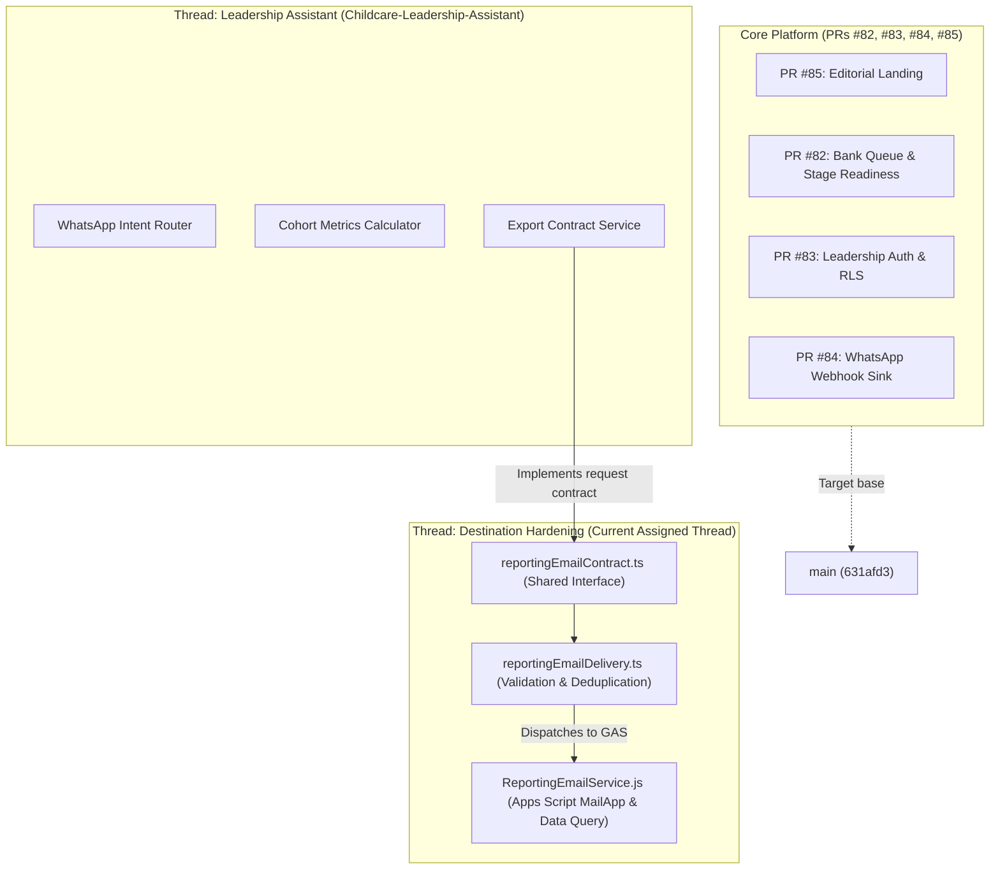

# Integration Board: Child Nutrition PWA (Phase 3)

Last Updated: 2026-10-15 (Overnight Cycle 1)

---

## 1. Thread & Worktree Status Matrix

| Thread ID | Worktree Directory | Branch Name | Head SHA | Target PR | CI Status | Status / Ownership Scope |
| :--- | :--- | :--- | :--- | :--- | :--- | :--- |
| **Thread-Landing** | `Childcare-Landing` | `feat/landing-page-experience` | `a09f28f` | **PR #85** | **Pass (All Green)** | Complete & ready for merge review. Hero intake preview, composed entrance, whole-child path motion, native FAQ details, dynamic reduced motion. Travelling-record animation deferred. |
| **Thread-Readiness** | `Childcare-PR82` | `feat/staged-readiness-bank-queue` | `b6de725` | **PR #82** | **Pass (All Green)** | Complete. Stage dimensions, decoupled bank workflow, OCC bank details modal, supervisor linelist export. |
| **Thread-Auth** | `Childcare-Support-Phase-3(1)` | `feat/leadership-email-auth` | `dc556aa` | **PR #83** | **Pass (All Green)** | Complete. Ephemeral PostgreSQL 15 integration in CI, rate limiting, advisory locks, idempotent identity provisioning. |
| **Thread-Combined** | `Childcare-Combined` | `test/combined-validation-82-83` | `6720a17` | — | **Pass** | Integration harness validating PR #82 + PR #83 joint execution without regression. |
| **05 — Receive-Only Webhook** | `Childcare-Catalyst-Adapter` | `feat/catalyst-whatsapp-adapter` | `8d6b6e9` | TBD | **Pass (All Green)** | Conversation `0ddf631f-33ee-4e21-a435-c7f94b998672`. Isolated receive-only test sink, timing-safe HMAC-SHA256 verification, PII redaction. No outbound messaging. 66 adapter tests, 797 full suite pass. |
| **04 — Reporting & Document Flow** | `Childcare-Leadership-Assistant` | `feat/leadership-reporting-assistant` | `21d5a18` | TBD | **Pass (All Green)** | Conversation `efc3f4cd-400c-4c68-ba10-93cc37a9d85e`. Reconciled Tigris storage worker + leadership assistant. WhatsApp document loop, magic bytes verification, storage rollback, durable persistence across restarts, 72/72 tests pass, 803/803 full-suite pass. |
| **Integration Coordinator / Outbound Sender** | `Childcare-Support-Phase-3(1)` *(Current)* | `feat/staging-destination-hardening` | `72f4e9f` | TBD | **Pass (121/121 Tests Green, 846 Full Suite)** | Conversation `5f42f2d2-d9e3-415b-a178-fc82456139f8`. Complete: Outbound WhatsApp sender adapter, persistent queue with leases & dead-lettering, migration 004, fail-closed production storage guards, E2E document loop reconciliation, and Bounded Overnight Controller with Antigravity-native planning fallback (11/11 controller tests pass). |

---

## 2. Integration Dependencies & Interfaces

---

## 3. Operational Rules & Boundaries

1. **Zero External Action**: No deployments, no live WhatsApp messages, no live emails sent, no calls made.
2. **Zero Operational/Beneficiary Data**: All test data, linelists, and fixtures are strictly synthetic (`isSynthetic: true`).
3. **Cross-Thread Branch Protection**: No thread may merge to `main` or modify another thread's branch without explicit instruction.
4. **Evidence-Driven**: Every claimed success must have an observed terminal log or test report attached.

---

## 4. Autonomous Local Task Queue & Acceptance Ledger

| Task ID | Task Title | Assigned Worktree & Branch | Status | Assigned Worker | Acceptance Evidence |
| :--- | :--- | :--- | :--- | :--- | :--- |
| **BOARD-TASK-001** | Verify Outbound WhatsApp Sender Contract & Queue Lease Durability | `Childcare-Support-Phase-3(1)` `feat/staging-destination-hardening` | **VERIFIED** | Worker `5e5c545d-f871-438b-afd6-e0b3ca81f6b4` (Role: Local Integration Auditor) | 27/27 vitest pass (`whatsapp-outbound-sender.test.ts`, `webhook-handoff-contract.test.ts`, `queue-concurrency-leases.test.ts`). `npm run typecheck` clean. Exit code 0. Zero external egress. |
| **BOARD-TASK-002** | Verify Controller Antigravity-Native Fallback & Lock Durability | `Childcare-Support-Phase-3(1)` `feat/staging-destination-hardening` | **PENDING** *(Next Unblocked)* | Antigravity Controller | Dependencies: `BOARD-TASK-001` (satisfied). Verification: `npx vitest run src/test/controller.test.ts` & `npm run typecheck`. |
| **BOARD-TASK-003** | Staging Cloud Migration & Remote Destination Egress | `Childcare-Support-Phase-3(1)` `feat/staging-destination-hardening` | **BLOCKED_APPROVAL** | Maintainer Required | Blocked: Requires explicit maintainer sign-off prior to applying migration 004 or configuring remote cloud destination credentials. |

