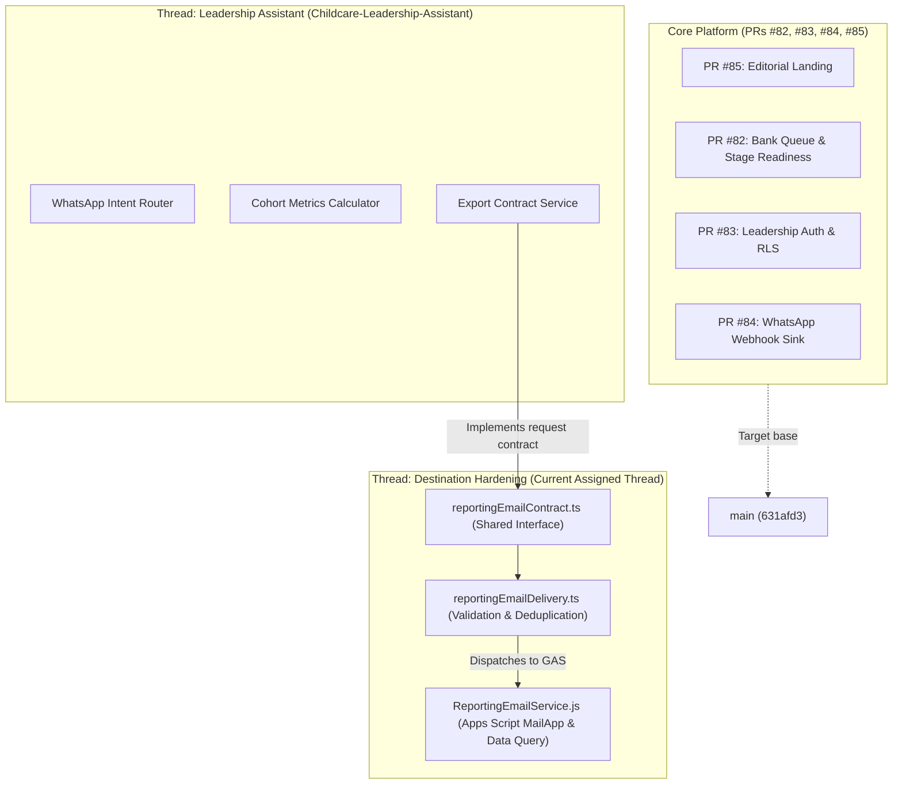

# Integration Board: Child Nutrition PWA (Phase 3)

Last Updated: 2026-10-15 (Overnight Cycle 1)

---

## 1. Thread & Worktree Status Matrix

| Thread ID | Worktree Directory | Branch Name | Head SHA | Target PR | CI Status | Status / Ownership Scope |
| :--- | :--- | :--- | :--- | :--- | :--- | :--- |
| **Thread-Landing** | `Childcare-Landing` | `feat/landing-page-experience` | `a09f28f` | **PR #85** | **Pass (All Green)** | Complete & ready for merge review. Hero intake preview, composed entrance, whole-child path motion, native FAQ details, dynamic reduced motion. Travelling-record animation deferred. |
| **Thread-Readiness** | `Childcare-PR82` | `feat/staged-readiness-bank-queue` | `b6de725` | **PR #82** | **Pass (All Green)** | Complete. Stage dimensions, decoupled bank workflow, OCC bank details modal, supervisor linelist export. |
| **Thread-Auth** | `Childcare-Support-Phase-3(1)` | `feat/leadership-email-auth` | `dc556aa` | **PR #83** | **Pass (All Green)** | Complete. Ephemeral PostgreSQL 15 integration in CI, rate limiting, advisory locks, idempotent identity provisioning. |
| **Thread-Combined** | `Childcare-Combined` | `test/combined-validation-82-83` | `6720a17` | — | **Pass** | Integration harness validating PR #82 + PR #83 joint execution without regression. |
| **Thread-WhatsApp** | `Childcare-Support-Phase-3(1)` | `feat/whatsapp-test-webhook` | `05072ee` | **PR #84** | **Pass (All Green)** | Complete. Isolated receive-only test sink, timing-safe HMAC-SHA256 verification, PII redaction. No outbound messaging. |
| **Thread-Leadership-UI** | `Childcare-Leadership-Assistant` | `feat/leadership-reporting-assistant` | `21d5a18` | TBD | **Pass (All Green)** | Reconciled backend document storage worker + leadership assistant. WhatsApp document loop, magic bytes verification, storage rollback, durable persistence across restarts, 72/72 tests pass, 803/803 full-suite pass. |
| **Thread-Backend-Hardening** | `Childcare-Support-Phase-3(1)` *(Current)* | `feat/staging-destination-hardening` | `df5d56b` | TBD | **Pass (All Tests Green)** | Complete: Read-only query adapter, artifact generator, registered recipient allowlist, persistent idempotency store, WhatsApp media worker, 50-record synthetic staging fixture (`fixtures/staging-linelist-synthetic.json`), and offline simulation bridge. Handoffs published: `docs/REPORTING_DATA_EMAIL_HANDOFF.md`, `docs/CROSS_THREAD_INTEGRATION_HANDOFF.md`. |

---

## 2. Integration Dependencies & Interfaces

---

## 3. Operational Rules & Boundaries

1. **Zero External Action**: No deployments, no live WhatsApp messages, no live emails sent, no calls made.
2. **Zero Operational/Beneficiary Data**: All test data, linelists, and fixtures are strictly synthetic (`isSynthetic: true`).
3. **Cross-Thread Branch Protection**: No thread may merge to `main` or modify another thread's branch without explicit instruction.
4. **Evidence-Driven**: Every claimed success must have an observed terminal log or test report attached.
