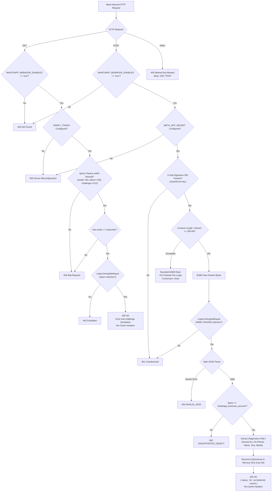
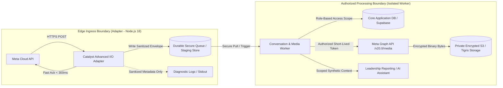

# WhatsApp Webhook & Zoho Catalyst Adapter: Integration Handoff Specification

**Document Version**: 1.0.0  
**Date**: October 15, 2026  
**Originating Branch**: `feat/catalyst-whatsapp-adapter`  
**Verified Baseline Commit**: `28a4c6a4bc4866c73b6617b3fa6eed60e41f9d3f`  
**Repository**: `Faribro/Childcare-Support---Phase-3-`  
**Target Audience**: Integration Coordinator, Infrastructure Lead, Downstream Processor Lead  

---

## 1. Adapter Lifecycle Contract: Ingestion, Validation, Acknowledgment & Discard

The Catalyst Advanced I/O adapter (`functions/whatsapp_webhook/index.js`) and its canonical TypeScript source (`src/lib/server/catalystWebhookAdapter.ts`) operate as an isolated, receive-only ingress boundary for Meta WhatsApp Cloud API webhooks.

### Detailed Breakdown

| Lifecycle Phase | Handled Elements | Technical Enforcement |
| :--- | :--- | :--- |
| **Receives** | • HTTP GET (Handshake) • HTTP POST (Event Webhook) • Raw socket stream | Dual runtime: native Node.js `(req, res)` listener and Express middleware |
| **Validates** | • Feature flag activation • Secret presence (fail-closed) • GET bounds (`mode` ≤ 64, `token` ≤ 256, `challenge` ≤ 512) • Hard body ceiling (256 KB) • Cryptographic signature • JSON syntax and Meta schema | • `WHATSAPP_WEBHOOK_ENABLED === 'true'` (404 otherwise) • Missing secrets return 500 without leaking keys • Constant-time HMAC comparison before JSON parse • Fast-rejection and bounded 64 KB drain on overflow (413) • `object === 'whatsapp_business_account'` check |
| **Acknowledges** | • Valid GET Handshake • Valid POST Event Payload | • GET: HTTP 200 with `hub.challenge` echoed as `text/plain; charset=utf-8` • POST: HTTP 200 JSON with sanitized `correlationId` and aggregate counts • Explicit RFC 7234 / 9111 `no-store, no-cache` headers on all responses |
| **Discards & Redacts** | • Unauthenticated payloads • Oversized requests • **ALL PII & Beneficiary Data** | • Unauthenticated/tampered payloads discarded prior to JSON parsing • Sockets torn down cleanly after bounded drain on 413 • **Permanently Stripped**: sender/recipient phone numbers (`from`, `recipient_id`, `wa_id`), contact profile names (`profile.name`), message text (`text.body`), image/doc/media captions, filenames, URLs, and raw WhatsApp message IDs (`wamid...`) • **Retained in Memory**: Random UUID `correlationId`, `eventClass`, aggregate item counts, numeric `errorCodes` |

---

## 2. Durable Business-Event Handoff Status: MISSING

> [!WARNING]
> **Durable business-event handoff does NOT exist in the current implementation.**
> 
> The adapter is currently configured strictly as an **ephemeral diagnostic edge receiver**.

### Gap Identification
1. **No Persistent Queue or Store**: The current adapter records processed events solely in an in-memory ring buffer (FIFO capacity of 50 records) via `src/lib/server/whatsappEventSink.ts`.
2. **Cold-Start & Lifecycle Volatility**: In serverless environments like Zoho Catalyst Advanced I/O, compute instances scale to zero and recycle. When an instance terminates, the in-memory ring buffer is discarded.
3. **No Downstream Business Dispatch**: The adapter does not dispatch events to any database (e.g. Supabase, Catalyst Data Store), Redis queue, Kafka/RabbitMQ bus, or webhook forwarding endpoint.
4. **Conclusion**: For the application to take business action on WhatsApp messages (e.g., triggering staff follow-ups, logging clinical responses, or triggering conversations), an authorized durable handoff mechanism must be designed and implemented by the integration coordinator.

---

## 3. Architectural Boundary for Downstream Conversation / Media Processing

To preserve the security, privacy, and responsiveness of the webhook receiver while enabling downstream business workflows, the following boundary architecture is recommended:

### Decoupling Rules
1. **Strict Synchronous Decoupling**:
   - The webhook receiver must never perform long-running business logic, LLM calls, or media downloads inside the synchronous HTTP request handler. Meta expects an acknowledgment within seconds; slow downstream execution risks duplicate deliveries and webhook throttling.
2. **Privacy Wall Between Edge Logs and Business Data**:
   - Diagnostic stdout logging in the adapter must remain strictly zero-PII.
   - If full message bodies or sender details are passed downstream, they must be transmitted over encrypted, authenticated internal channels (e.g., an encrypted Postgres staging table or private queue) with strict Row-Level Security (RLS) and zero diagnostic leakage.
3. **Media Isolation**:
   - WhatsApp media items arrive as ephemeral media IDs (`messages[].image.id`), not binary bytes.
   - Fetching media requires an authorized system user access token against `https://graph.facebook.com/v20.0/{media-id}`.
   - Downloaded media must be streamed directly into private encrypted object storage (e.g., S3/Tigris) with presigned, role-scoped URLs. Media URLs or raw binary bytes must never appear in serverless function logs.
4. **Context & Scope Boundary**:
   - Downstream processors (such as the Leadership Reporting Assistant on branch `feat/leadership-reporting-assistant`) must connect via an authorized read-only data adapter with explicit geographic/state authorization scopes, completely separated from user-supplied filters.

---

## 4. Deployment Prerequisites, Rollback & Unresolved Platform Questions

### A. Exact Deployment Prerequisites

Before running deployment commands, the following operational prerequisites must be verified by the infrastructure lead:

1. **Catalyst CLI Environment**:
   - Node.js LTS installed (`>=18.18.0`).
   - Catalyst CLI installed: `npm install -g zcatalyst-cli`.
   - Active CLI session: `catalyst login`.
2. **Project Association**:
   - Associate with project: `catalyst project:use Project-Rainfall`.
3. **Environment Configuration**:
   - Configure secrets in the Catalyst Web Console (**Serverless > Functions > whatsapp_webhook > Configuration > Environment Variables**):
     - `WHATSAPP_WEBHOOK_ENABLED`: `"true"`
     - `WHATSAPP_WEBHOOK_VERIFY_TOKEN`: `<high-entropy-random-string>`
     - `META_APP_SECRET`: `<meta-app-secret-from-dashboard>`
4. **Reproducible Packaging**:
   - Compile self-contained artifact: `node scripts/package-catalyst-adapter.mjs` (or `npm run build:catalyst`).
   - Output directory `functions/whatsapp_webhook/` must contain: `index.js`, `whatsappWebhookConfig.js`, `whatsappWebhookVerifier.js`, `whatsappWebhookParser.js`, `whatsappEventSink.js`, `catalyst-config.json`, `package.json`, and `README.md`.
5. **Deployment Command**:
   - Execute targeted deployment: `catalyst deploy --only functions:whatsapp_webhook`.

### B. Rollback Procedures

| Scenario | Rollback Action | Execution Time | Impact |
| :--- | :--- | :--- | :--- |
| **Instant Ingress Shutdown (Emergency)** | Set environment variable `WHATSAPP_WEBHOOK_ENABLED="false"` in Catalyst Console. | < 1 minute | Adapter immediately rejects all incoming requests with HTTP 404. No code deployment needed. |
| **Meta Disconnection** | Clear or modify the Callback URL in the Meta Developer Dashboard (**WhatsApp > Configuration**). | < 2 minutes | Meta stops dispatching webhooks to Catalyst completely. |
| **Code Rollback** | Re-run `catalyst deploy --only functions:whatsapp_webhook` from previous stable commit `51d52b04d12ddc5b36125a1d5288b894d93ac04d`. | ~ 3 minutes | Reverts adapter execution code to previous revision. |

### C. Unresolved Permissions & Billing Questions

The following questions require verification directly in the Zoho Catalyst Web Console by the infrastructure owner:

1. **Public Invocation Access Rules**:
   - *Question*: Does the generated Catalyst Advanced I/O function URL allow unauthenticated public HTTP access, or does default Catalyst API Gateway security require Zoho client authentication / IAM tokens?
   - *Requirement*: Meta Webhooks are invoked by Meta's edge servers with HMAC signatures; they cannot perform Zoho SSO login. The URL must permit unauthenticated ingress.
2. **Account Billing & Credit Status**:
   - *Evidence*: `Project-Rainfall` currently shows Free Tier with `₹0` in Zoho Billing Credits.
   - *Question*: Is the $250 promotional credit applied or pending? If on the pure Free Tier, what are the exact monthly execution limits, concurrency caps, and function timeout limits for Advanced I/O functions?
3. **Environment Target**:
   - *Question*: Should the initial isolated verification function be deployed to `Development` or `Production` environment in Project-Rainfall?

---

## 5. Artifact & Verification Index

| Component | Path / Location | SHA / Revision | Test Status |
| :--- | :--- | :--- | :--- |
| **Catalyst Adapter Source** | [`src/lib/server/catalystWebhookAdapter.ts`](file:///D:/OneDrive%20-%20INDIA%20HIV%20AIDS%20ALLIANCE/Desktop/Software%20Development/Childcare-Catalyst-Adapter/src/lib/server/catalystWebhookAdapter.ts) | `28a4c6a` | Verified |
| **Packaged Artifact** | `functions/whatsapp_webhook/index.js` | Built via `ts.transpileModule` | Verified Standalone |
| **Fixture Factory** | [`src/test/fixtures/whatsappSyntheticFixtures.ts`](file:///D:/OneDrive%20-%20INDIA%20HIV%20AIDS%20ALLIANCE/Desktop/Software%20Development/Childcare-Catalyst-Adapter/src/test/fixtures/whatsappSyntheticFixtures.ts) | `28a4c6a` | Verified |
| **Scenario Runner** | [`scripts/test-whatsapp-webhook.mjs`](file:///D:/OneDrive%20-%20INDIA%20HIV%20AIDS%20ALLIANCE/Desktop/Software%20Development/Childcare-Catalyst-Adapter/scripts/test-whatsapp-webhook.mjs) | `28a4c6a` | 6/6 Scenarios Pass |
| **Automated Tests** | [`src/test/catalyst-adapter.test.ts`](file:///D:/OneDrive%20-%20INDIA%20HIV%20AIDS%20ALLIANCE/Desktop/Software%20Development/Childcare-Catalyst-Adapter/src/test/catalyst-adapter.test.ts) [`src/test/whatsapp-webhook.test.ts`](file:///D:/OneDrive%20-%20INDIA%20HIV%20AIDS%20ALLIANCE/Desktop/Software%20Development/Childcare-Catalyst-Adapter/src/test/whatsapp-webhook.test.ts) | `28a4c6a` | **66/66 Tests Passing (100%)** |
| **Integration Ledger** | [`docs/INTEGRATION_BOARD_AND_DECISION_LEDGER.md`](file:///D:/OneDrive%20-%20INDIA%20HIV%20AIDS%20ALLIANCE/Desktop/Software%20Development/Childcare-Catalyst-Adapter/docs/INTEGRATION_BOARD_AND_DECISION_LEDGER.md) | `28a4c6a` | Up-to-date |
