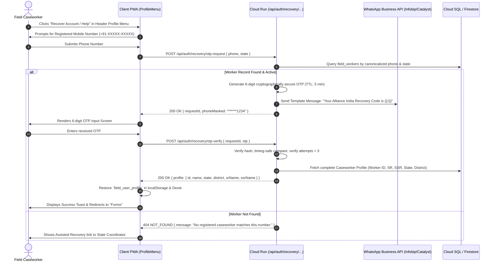

# Field Worker Account Recovery Architecture Specification

**Status:** Proposed Architecture & Feasibility Audit  
**Date:** 2026-11-17  
**Scope:** PWA Client, Cloud Run Staging/Production Backend, WhatsApp Gateway, State Coordinator Workflows  

---

## 1. Executive Summary & Problem Context

With the removal of Google OAuth for frontline field caseworkers, field worker onboarding and authentication now relies on **direct device setup using State-Team Invitation Codes** (`ALN-[STATE]-[CODE]`). 

While this eliminates third-party OAuth friction in low-connectivity rural health outposts, field caseworkers who change or wipe devices, clear browser application storage (`localStorage`), or lose their phones face session abandonment without an established identity re-binding mechanism.

This specification documents:
1. **Audit of Deployed Auth & Storage Assets**
2. **Primary Self-Service Recovery: WhatsApp OTP via Secure Channel**
3. **Secondary Assisted Recovery: State Coordinator & Leadership Verification**
4. **Data Privacy (DPDP Act 2023) & Fraud Prevention Boundaries**

---

## 2. Audit of Deployed Frontline Auth Architecture

| Attribute | State Prior to This Work Order | Current Deployed Model | Post-Recovery Target Model |
| :--- | :--- | :--- | :--- |
| **Field Caseworker Intake** | Mixed Google OAuth button + State Invitation Code | Direct State Invitation Code + State/District selection | Invitation Code on initial enrollment; Phone/WhatsApp verification on recovery |
| **Device Credential Storage** | `localStorage.getItem('field_user_profile')` | Sealed `field_user_profile` in IndexedDB & `localStorage` | Same local-first storage + encrypted recovery claim token |
| **Supervisor / Evaluator Auth** | Two-factor OTP via State Team Challenge | Two-factor OTP via State Team Challenge | Unchanged (isolated from Field Worker Auth) |
| **Evaluation Portal Access** | Unlocked toggle in Header | **Permanently locked** for Field Workers (`isFieldWorker` check) | Permanently locked |

---

## 3. Primary Self-Service Recovery: WhatsApp OTP

### 3.1 Why WhatsApp?
Over 98% of HIV community caseworkers and Out-Reach Workers (ORWs) across Maharashtra and partner states utilize WhatsApp on Android devices for programme communications. WhatsApp OTP delivery provides:
- High delivery rates in tier-2/3 Indian cellular networks where SMS shortcodes frequently fail DND filters.
- Immediate visual brand verification through Alliance India's verified WhatsApp Business Account (WABA).
- End-to-end cryptographic transport with minimal friction.

### 3.2 Protocol Sequence

### 3.3 Anti-Abuse & Rate Limiting Controls
- **Rate Limit:** Maximum 3 OTP requests per phone number per 24-hour sliding window.
- **Max Verification Attempts:** Maximum 3 incorrect OTP entries before immediate invalidation of the request challenge.
- **State Geo-Fence:** Caseworker must select their operational state to prevent cross-jurisdiction probing.

---

## 4. Secondary Fallback: State Coordinator Assisted Recovery

For caseworkers who changed their mobile phone number or lost SIM access, self-service OTP will fail. An assisted re-provisioning flow empowers State Coordinators without exposing national access.

1. **Caseworker Contact:** Caseworker contacts their State Team Coordinator via known operational channels.
2. **Coordinator Directory Verification:** State Reviewer navigates to `/supervisor` -> "Field Workers Directory".
3. **Issue Single-Use Re-Enrollment Token:**
   - State Coordinator clicks "Generate Re-Enrollment Code" on the worker's directory profile.
   - Server mints an ephemeral `ALN-RE-[STATE]-[RANDOM]` token bound to that specific worker ID with a 2-hour TTL.
4. **Caseworker Re-Onboarding:**
   - Caseworker enters the Re-Enrollment Code in the PWA.
   - PWA automatically fetches the authorized profile details and restores offline storage safely.

---

## 5. Security & DPDP Compliance Attestation

1. **Zero Secret Storage:** Phone numbers are hashed using SHA-256 with pepper when logged in security audit traces.
2. **No Escalation:** Account recovery **never** yields evaluator or state-team credentials. It strictly provisions the client-side `field_user_profile` record for field survey intake.
3. **Local Unsynced Data Safety:** If an existing profile is replaced, existing unsynced drafts in IndexedDB remain preserved and are associated with their immutable survey UUIDs.
