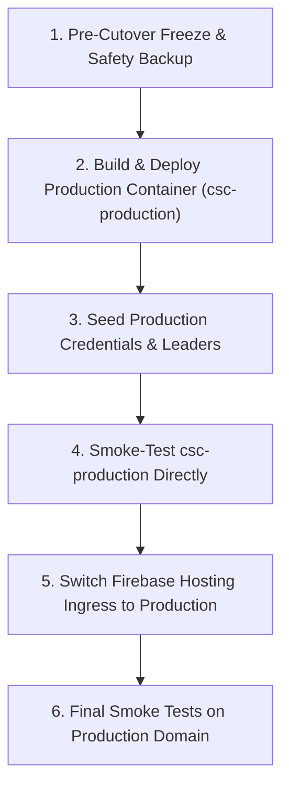

# Childcare Support Phase 3: Google Cloud Platform Migration Guide

**Target Environment**: Google Cloud Platform (Region: `asia-south1`)  
**Project ID**: `cs-p3-production`  
**Databases**: `staging` (Staging) and `(default)` (Production)  
**Cloud Storage**: `cs-p3-childcare-staging` (Staging bucket)  
**Service Account**: `csc-runtime@cs-p3-production.iam.gserviceaccount.com`  

---

## 1. Initial Account Provisioning & Fresh Start Architecture

> [!IMPORTANT]
> **Data Decision: Fresh Start on Google Cloud**  
> All existing records in Supabase (`rjrctsxdvkfkssqvmhbz`), the historical Google Sheet, and Tigris are dummy/test records. The migration to Google Cloud starts fresh:
> - No data migration scripts are executed (`migrate-supabase-to-firestore`, `migrate-sheets-to-firestore`, `migrate-tigris-to-gcs` have been dropped).
> - `scripts/export-sheets-backup.ts` is retained as a read-only safety snapshot.
> - Provisioning is conducted exclusively through deterministic seed scripts (`seed-credentials`, `seed-leader-identities`).

### Critical Bootstrap Gate
In production and staging environments on Cloud Run, the application operates under `DATA_ENGINE=firestore` and strictly disables environment-variable account fallback (`ALLOW_ENV_CREDENTIAL_FALLBACK=false`).

**Without running the seed scripts below, the Firestore database will be empty, and nobody will be able to sign in.**

### Provisioning Workflow
1. **Seed Evaluation Credentials (`scripts/seed-credentials.ts`)**:
   - Reads accounts from a local JSON file (identifier, role, state, districts).
   - Generates cryptographically random one-time passwords for each account.
   - Hashes passwords with Argon2id and writes credential records to Firestore collection `evaluation_credentials`.
   - **Prints one-time credentials ONCE directly to the local terminal session**. Passwords are never written to disk, git, or log files.
   - Runs in `--dry-run` mode by default. Targets `staging` database by default. Refuses `(default)` production database unless `--confirm-production` is explicitly passed.

2. **Seed Leadership Allowlist (`scripts/seed-leader-identities.ts`)**:
   - Reads allowlisted leaders from a local JSON file or `LEADERSHIP_ALLOWLIST_JSON`.
   - Populates the `leader_identities` collection in Firestore.

3. **Reset Staging (`scripts/reset-staging.ts`)**:
   - Wipes all test documents from `staging` Firestore collections and test objects from `cs-p3-childcare-staging`.
   - Requires interactive confirmation.
   - Hardcoded refusal guard: strictly aborts if attempted against `(default)` database or production bucket.

### Environment Variable Matrix (Names Only)

| Environment Variable | Classification | Target Tier | Staging Value / Behavior | Production Value / Behavior |
|---|---|---|---|---|
| `APP_ENV` | REQUIRED | Container Env | `staging` | `production` |
| `NODE_ENV` | REQUIRED | Container Env | `production` | `production` |
| `GOOGLE_CLOUD_PROJECT` | REQUIRED | Container Env | `cs-p3-production` | `cs-p3-production` |
| `DATA_ENGINE` | REQUIRED | Container Env | `firestore` | `firestore` |
| `STORAGE_PROVIDER` | REQUIRED | Container Env | `gcs` | `gcs` |
| `FIRESTORE_DATABASE_ID` | REQUIRED | Container Env | `staging` | `(default)` |
| `GCS_BUCKET_NAME` | REQUIRED | Container Env | `cs-p3-childcare-staging` | `cs-p3-childcare-production` |
| `GCS_SIGNING_SERVICE_ACCOUNT`| REQUIRED | Container Env | `csc-runtime@cs-p3-production...` | `csc-runtime@cs-p3-production...` |
| `SESSION_SECRET` | REQUIRED | Secret Manager | Staging Session Secret | Production Session Secret |
| `WEBHOOK_SECRET` | REQUIRED | Secret Manager | Staging Apps Script Webhook Key | Production Apps Script Webhook Key |
| `ARGON2_PEPPER` | REQUIRED | Secret Manager | Cryptographic Pepper (Argon2id) | Cryptographic Pepper (Argon2id) |
| `LEADERSHIP_AUTH_SECRET` | REQUIRED | Secret Manager | Leadership OTP Hashing Secret | Leadership OTP Hashing Secret |
| `UNIFIED_COOKIE_SIGNING_KEY` | REQUIRED | Secret Manager | Cookie HMAC-SHA256 Signing Key | Cookie HMAC-SHA256 Signing Key |
| `CRON_SECRET` | REQUIRED | Secret Manager | Cloud Scheduler Bearer Secret | Cloud Scheduler Bearer Secret |
| `DIAGNOSTICS_SECRET` | REQUIRED | Secret Manager | Timing-Safe Diagnostics Secret | Timing-Safe Diagnostics Secret |
| `APPS_SCRIPT_URL` | REQUIRED | Container Env | Staging Apps Script URL | Production Apps Script URL |
| `COOKIE_STRATEGY` | OPTIONAL | Container Env | `unified` (Firebase Hosting) | `unified` (Firebase Hosting) |
| `ALLOW_LIVE_EMAIL_DISPATCH` | ENVIRONMENT GUARD| Container Env | `false` (Strict mock delivery) | `true` (Live delivery to leaders) |
| `EXPORT_DELIVERY_JOB_RETENTION_DAYS`| OPTIONAL | Container Env | `90` | `90` |
| `LEADERSHIP_SINGLE_ACTIVE_SESSION` | OPTIONAL | Container Env | `false` (Default: multi-session) | `false` (Default: multi-session) |
| `GOOGLE_CLIENT_ID` / `_SECRET` | OPTIONAL | Secret Manager | Staging OAuth Credentials | Production OAuth Credentials |
| `SUPABASE_*` / `TIGRIS_*` | ROLLBACK ONLY | Legacy Vercel | Used only if rolled back | Used only if rolled back |

---

## 2. Cookie Architecture: Firebase Hosting vs. Direct Cloud Run

### A. The Firebase Hosting Cookie Limitation
When traffic is routed through Firebase Hosting rewrites (`cs-p3-production.web.app` or custom domain rewrite) to Google Cloud Run, **Firebase Hosting strips all incoming `Cookie` and outgoing `Set-Cookie` headers EXCEPT a cookie named exactly `__session`**.

Furthermore, Firebase Hosting CDN caches static and dynamic responses unless instructed otherwise. If `Cache-Control` does not disallow caching, Firebase Hosting will strip outgoing `Set-Cookie: __session` headers at the edge!

### B. Complete Application Cookie Inventory

| Cookie Name | Purpose | Flags | Lifespan | Handled Behind Hosting |
| :--- | :--- | :--- | :--- | :--- |
| `evaluation_session_token` (alias: `session_token`) | Authenticated session token for State Reviewers, Admins, and Field Coordinators (HMAC-SHA256 JWT) | `HttpOnly`, `SameSite=Lax`, `Path=/`, `Secure` | 8 hours (28,800s) | Stripped by Hosting unless unified into `__session` |
| `leader_session_id` (alias: `leader_session_token`) | Opaque session ID for individual allowlisted leadership logins | `HttpOnly`, `SameSite=Lax`, `Path=/`, `Secure` | 8 hours (28,800s) | Stripped by Hosting unless unified into `__session` |
| `leader_device_binding` | 128-bit browser cryptographic secret bound to OTP challenge to prevent cross-device phishing and session hijacking | `HttpOnly`, `SameSite=Lax`, `Path=/`, `Secure` | 30 days (2,592,000s) | Stripped by Hosting unless unified into `__session` |
| `google_oauth_state` | Ephemeral CSRF state token for Google OAuth flow | `HttpOnly`, `SameSite=Lax`, `Path=/`, `Secure` | 15 minutes (900s) | Stripped by Hosting unless unified into `__session` |
| `field_onboarding_ticket` | Signed token carrying verified Google identity (`googleSub`, email, name) to profile registration form | `HttpOnly`, `SameSite=Lax`, `Path=/`, `Secure` | 30 minutes (1,800s) | Stripped by Hosting unless unified into `__session` |

### C. The Unified `__session` Cookie Solution
To ensure flawless operation behind Firebase Hosting with **zero security regressions**:
- We provide `src/lib/server/unifiedSessionCookie.ts`.
- When `COOKIE_STRATEGY=unified` or `USE_UNIFIED_SESSION_COOKIE=true` is set, all session tokens and the device binding secret are multiplexed into a single `__session` cookie.
- **Cryptographic Envelope**: The cookie contains a signed JSON envelope signed with `SESSION_SECRET` via HMAC-SHA256:
  ```json
  {
    "evalToken": "...",
    "leaderSessionId": "...",
    "leaderDeviceSecret": "...",
    "oauthState": "...",
    "onboardingTicket": "...",
    "iat": 1731500000000,
    "exp": 1731528800000
  }
  ```
- **Integrity Guarantee**: Tampered envelopes, modified signatures, or expired timestamps are rejected with constant-time verification (`crypto.timingSafeEqual`).
- **Device Binding Intact**: The `leaderDeviceSecret` is preserved across the `request-code` -> `verify-code` flow, maintaining full anti-phishing protection.
- **Anti-Caching Enforcement**: All cookie-mutating endpoints and all `/api/*` routes return:
  ```http
  Cache-Control: private, no-store, no-cache, max-age=0, must-revalidate
  Pragma: no-cache
  ```
  This ensures Firebase Hosting passes `Set-Cookie: __session` through to the browser and never caches authenticated responses at the edge.

### D. Domain Mapping & Routing Architecture
- **Firebase Hosting as Primary Path**: Firebase Hosting (`cs-p3-production.web.app` / `cs-p3-production.firebaseapp.com`) is the primary, production-supported ingress path. It provides global CDN caching for public assets, TLS termination, and edge rewrites to Cloud Run. The unified `__session` cookie architecture was built specifically to guarantee zero session loss across Firebase Hosting.
- **Direct Cloud Run Domain Mapping Status**: Direct domain mapping (`gcloud beta run domain-mappings create`) is **unconfirmed/untested in `asia-south1`** (domain mapping features are not universally GA in all regional tiers).
- **Environment Separation**: Staging strictly routes through `.a.run.app` (`csc-staging-*.asia-south1.run.app`) and Firebase Hosting (`cs-p3-production.web.app`). Staging **never** binds to the apex production domain.
- **Production Custom Domain**: For production cutover, `childcare.allianceindia.org` will be mapped via Firebase Hosting Custom Domains (or direct Cloud Run domain mapping for `csc-production` if verified).

---

## 3. Separate Container Builds for Staging and Production

> [!IMPORTANT]
> **Build-Time Inlining of `NEXT_PUBLIC_*` Variables**  
> In Next.js, all environment variables prefixed with `NEXT_PUBLIC_*` are statically replaced and inlined into client JavaScript bundles at compile time (`npm run build`).
>
> Therefore, **a container image compiled for Staging CANNOT be promoted to Production**. Doing so would bake staging public configurations, API URLs, and storage bucket names into production client browsers.
>
> **Staging and Production require separate, dedicated container builds.**

### Build-Time Verification Guard
To prevent accidental misconfiguration, `next.config.mjs` enforces a strict compile-time check:
- If `APP_ENV=staging` is targeted, `NEXT_PUBLIC_APP_ENV` must also be `staging`.
- If `APP_ENV=production` is targeted, `NEXT_PUBLIC_APP_ENV` must also be `production`.
- Any mismatch immediately throws `[BUILD GUARD] Environment mismatch` and aborts compilation before the image can be built.

### Cloud Build Commands (Windows PowerShell Syntax)

Cloud Build configurations `cloudbuild.staging.yaml` and `cloudbuild.production.yaml` manage the build arguments and push directly to Artifact Registry. `gcloud builds submit --build-arg` is invalid; use `--config` with substitutions:

```powershell
# STAGING BUILD (PowerShell)
gcloud builds submit `
  --config=cloudbuild.staging.yaml `
  --substitutions=_GIT_COMMIT_SHA="$(git rev-parse --short HEAD)" `
  --project=cs-p3-production

# PRODUCTION BUILD (PowerShell)
gcloud builds submit `
  --config=cloudbuild.production.yaml `
  --substitutions=_GIT_COMMIT_SHA="$(git rev-parse --short HEAD)" `
  --project=cs-p3-production
```

---

## 4. Single Runtime Service Account: `csc-runtime`

To eliminate configuration drift and permission fragmentation, exactly **one runtime service account** is used across all environments and documentation:

* **Identity**: `csc-runtime@cs-p3-production.iam.gserviceaccount.com`
* **Roles Granted**:
  1. `roles/datastore.user` (Firestore native read/write)
  2. `roles/storage.objectAdmin` (Cloud Storage bucket read/write/delete)
  3. `roles/iam.serviceAccountTokenCreator` (Keyless V4 signed URL self-generation)
  4. `roles/secretmanager.secretAccessor` (Runtime secret decryption)

---

## 5. Firestore Collection Inventory & TTL Policies

### A. Brute-Force & Account Lockout Defense (`auth_attempts` / `auth_lockouts`)
In multi-instance Cloud Run containers with scale-to-zero, in-memory rate limiting counters reset when instances shut down. An attacker could distribute brute-force password guessing across container instances.

To solve this:
- **`auth_attempts` & `auth_lockouts`**: Stored in Firestore when `DATA_ENGINE=firestore`.
- **Atomic Windows**: Tracks sliding-window failed attempts per credential (`CREDENTIAL_KEY:IP`) and per IP globally (`IP`). Document IDs are sanitized to alphanumeric + hyphen characters.
- **Lockout Enforcement**:
  - 5 failed attempts on a credential: 15-minute credential lockout.
  - 20 failed attempts on an IP: 15-minute global IP lockout.
- **TTL Expiration**: Documents write an `expiresAt` timestamp field. Cloud Firestore native TTL automatically deletes expired attempt and lockout records without background cron overhead.

### B. Complete Collection Inventory

| Collection Name | Purpose | Security Policy | TTL Field | Automatic Expiration |
| :--- | :--- | :--- | :--- | :--- |
| `submissions` | Beneficiary assessments & demographic data | Admin SDK only (`allow: if false`) | None | Permanent durable record |
| `attachment_metadata` | GCS file references, MIME types, signed URL tokens | Admin SDK only (`allow: if false`) | None | Permanent durable record |
| `sheets_mirror_retry_queue` | Upstream Google Sheets synchronization retry queue | Admin SDK only (`allow: if false`) | None | Deleted upon successful drain |
| `evaluation_credentials` | Argon2id-hashed evaluation accounts | Admin SDK only (`allow: if false`) | None | Active until rotated |
| `auth_attempts` | Distributed failed login attempts sliding window | Admin SDK only (`allow: if false`) | `expiresAt` | Lockout window + 5 min (~20m) |
| `auth_lockouts` | Dedicated credential/IP temporary lockout registry | Admin SDK only (`allow: if false`) | `expiresAt` | Lockout duration (~15m-1h) |
| `leadership_sessions` | Active individual leadership session records | Admin SDK only (`allow: if false`) | `expiresAt` | Inactivity (30m) or Absolute (8h) |
| `leader_otp_challenges` | Single-use 128-bit OTP challenge records | Admin SDK only (`allow: if false`) | `expiresAt` | 10 minutes |
| `leader_identities` | Allowlisted leadership directory & roles | Admin SDK only (`allow: if false`) | None | Active until revoked |
| `state_team_registrations` | Pending/approved state coordinator profiles | Admin SDK only (`allow: if false`) | None | Active profile |
| `state_team_invitations` | Single-use field caseworker invitations | Admin SDK only (`allow: if false`) | `expiresAt` | 7 days |
| `state_team_challenges` | State coordinator OTP email challenges | Admin SDK only (`allow: if false`) | `expiresAt` | 15 minutes |
| `field_user_profiles` | Verified field caseworker profiles (Google Auth) | Admin SDK only (`allow: if false`) | None | Active profile |
| `export_preview_contracts` | Ephemeral signed export download contracts | Admin SDK only (`allow: if false`) | `expiresAt` | 15 minutes |
| `export_delivery_jobs` | Bulk export delivery job state and progress | Admin SDK only (`allow: if false`) | `expiresAt` | Configurable (default 90 days) |
| `export_audit_events` | Immutable security audit logs of exported PII | Admin SDK only (`allow: if false`) | None | Permanent compliance record |

### C. Exact gcloud TTL Commands (Documented Only)

Run these commands to enable native Firestore TTL policies on the expiring collections for both databases:

```bash
# ------------------------------------------------------------------------------
# STAGING DATABASE (staging)
# ------------------------------------------------------------------------------
gcloud firestore fields ttls update expiresAt \
  --collection-group=auth_attempts \
  --database=staging \
  --project=cs-p3-production \
  --enable-ttl

gcloud firestore fields ttls update expiresAt \
  --collection-group=auth_lockouts \
  --database=staging \
  --project=cs-p3-production \
  --enable-ttl

gcloud firestore fields ttls update expiresAt \
  --collection-group=leadership_sessions \
  --database=staging \
  --project=cs-p3-production \
  --enable-ttl

gcloud firestore fields ttls update expiresAt \
  --collection-group=leader_otp_challenges \
  --database=staging \
  --project=cs-p3-production \
  --enable-ttl

gcloud firestore fields ttls update expiresAt \
  --collection-group=state_team_challenges \
  --database=staging \
  --project=cs-p3-production \
  --enable-ttl

gcloud firestore fields ttls update expiresAt \
  --collection-group=state_team_invitations \
  --database=staging \
  --project=cs-p3-production \
  --enable-ttl

gcloud firestore fields ttls update expiresAt \
  --collection-group=export_delivery_jobs \
  --database=staging \
  --project=cs-p3-production \
  --enable-ttl

# ------------------------------------------------------------------------------
# PRODUCTION DATABASE ((default))
# ------------------------------------------------------------------------------
gcloud firestore fields ttls update expiresAt \
  --collection-group=auth_attempts \
  --database="(default)" \
  --project=cs-p3-production \
  --enable-ttl

gcloud firestore fields ttls update expiresAt \
  --collection-group=auth_lockouts \
  --database="(default)" \
  --project=cs-p3-production \
  --enable-ttl

gcloud firestore fields ttls update expiresAt \
  --collection-group=leadership_sessions \
  --database="(default)" \
  --project=cs-p3-production \
  --enable-ttl

gcloud firestore fields ttls update expiresAt \
  --collection-group=leader_otp_challenges \
  --database="(default)" \
  --project=cs-p3-production \
  --enable-ttl

gcloud firestore fields ttls update expiresAt \
  --collection-group=state_team_challenges \
  --database="(default)" \
  --project=cs-p3-production \
  --enable-ttl

gcloud firestore fields ttls update expiresAt \
  --collection-group=state_team_invitations \
  --database="(default)" \
  --project=cs-p3-production \
  --enable-ttl

gcloud firestore fields ttls update expiresAt \
  --collection-group=export_delivery_jobs \
  --database="(default)" \
  --project=cs-p3-production \
  --enable-ttl
```

---

## 6. Staging Smoke-Test Checklist

Perform these sequential, end-to-end verifications once `csc-staging` is deployed:

- [ ] **1. Health & Readiness Probes**:
  - Request `GET /api/health` -> verify HTTP 200, commit revision, and subsystem statuses (`firestore: ok`, `storageBucket: ok`, `appsScript: ok`).
  - Request `GET /api/ready` -> verify HTTP 200.
- [ ] **2. Field Worker Onboarding & Ticket Validation**:
  - Open `/auth/field-user/onboarding` -> supply test onboarding token.
  - Complete registration with PIN -> verify record written to Firestore `field_user_profiles`.
- [ ] **3. State Evaluation Login & Distributed Lockout**:
  - Sign in with seeded `STATE-MH` credential -> verify session established.
  - Attempt 5 invalid logins from an IP -> verify HTTP 429 Account Locked via distributed Firestore rate limiter (`auth_attempts` and `auth_lockouts`).
- [ ] **4. Leadership Passwordless Email OTP Login**:
  - Request OTP code for allowlisted leader -> verify mock/staging email logged.
  - Verify OTP code on the same browser device -> verify unified `__session` cookie set with `Cache-Control: private, no-store`.
  - Confirm single active session behavior (configurable via `LEADERSHIP_SINGLE_ACTIVE_SESSION`).
- [ ] **5. Beneficiary Assessment Intake**:
  - Create beneficiary submission in Maharashtra -> verify record saved to Firestore `submissions`.
  - Re-send same `clientSubmissionId` -> verify duplicate is acknowledged idempotently without double-counting.
- [ ] **6. Offline Queue & Client Reconnect Sync**:
  - In browser devtools, toggle **Offline Mode**.
  - Submit a new assessment draft -> confirm saved to IndexedDB local queue.
  - Toggle **Online Mode** -> confirm client sync worker automatically replays and drains to `/api/submissions`.
- [ ] **7. Document Upload & GCS Keyless Signed URLs**:
  - Upload child photo (JPEG) and consent document (PDF) -> verify keyless V4 signed PUT URL generated by `csc-runtime`.
  - Confirm `x-goog-content-length-range` enforces 3 MB ceiling directly on Google Cloud Storage.
  - View uploaded attachment -> confirm signed GET URL renders document securely with 15-minute expiry.
- [ ] **8. Supervisor Dashboard & Paginated Linelist**:
  - Access `/supervisor/assessments` -> verify paginated query executes with `limit=100`.
  - Verify geographic access scoping: Maharashtra supervisor only sees Maharashtra records.
- [ ] **9. Report Export & Audit Trail**:
  - Initiate report export from supervisor portal -> verify confirmation token generated.
  - Confirm export download -> verify event logged permanently to `export_audit_events`.
- [ ] **10. Secondary Sheets Mirror & Resilient Outage Replay**:
  - Check Google Sheet mirror -> verify new row appears with all 85 columns populated.
  - Temporarily disable Apps Script webhook -> submit new survey -> verify submission returns HTTP 200 `acknowledged: true` with `PENDING_SHEET_SYNC` status.
  - Verify failed mirror job is queued in Firestore `sheets_mirror_retry_queue`.
  - Re-enable Apps Script webhook -> invoke `POST /api/workers/cron` with `x-cron-auth: <CRON_SECRET>` -> verify retry queue drains to `SYNCED`.

---

## 7. Production Cutover Sequence

Execute the production cutover during the scheduled maintenance window (recommended: Sunday 02:00 – 04:00 IST):



### Phase 1: Pre-Cutover Freeze & Safety Backup
1. Notify field teams of the 2-hour maintenance window.
2. Run read-only Google Sheets safety backup:
   ```powershell
   bun run scripts/export-sheets-backup.ts
   ```
3. Confirm backup JSON file is safely archived locally.

### Phase 2: Production Container Build & Deploy
1. Build production image using `cloudbuild.production.yaml`:
   ```powershell
   gcloud builds submit --config=cloudbuild.production.yaml --substitutions=_GIT_COMMIT_SHA="$(git rev-parse --short HEAD)" --project=cs-p3-production
   ```
2. Deploy Cloud Run service `csc-production`:
   ```powershell
   gcloud run deploy csc-production `
     --image="asia-south1-docker.pkg.dev/cs-p3-production/csc-containers/csc-production:latest" `
     --region=asia-south1 `
     --platform=managed `
     --allow-unauthenticated `
     --service-account=csc-runtime@cs-p3-production.iam.gserviceaccount.com `
     --min-instances=1 `
     --max-instances=5 `
     --memory=1Gi `
     --cpu=1 `
     --cpu-throttling `
     --port=8080 `
     --set-env-vars="APP_ENV=production,DATA_ENGINE=firestore,STORAGE_PROVIDER=gcs,FIRESTORE_DATABASE_ID=(default),GCS_BUCKET_NAME=cs-p3-childcare-production,COOKIE_STRATEGY=unified,ALLOW_LIVE_EMAIL_DISPATCH=true" `
     --set-secrets="SESSION_SECRET=SESSION_SECRET:latest,WEBHOOK_SECRET=WEBHOOK_SECRET:latest,ARGON2_PEPPER=ARGON2_PEPPER:latest,LEADERSHIP_AUTH_SECRET=LEADERSHIP_AUTH_SECRET:latest,UNIFIED_COOKIE_SIGNING_KEY=UNIFIED_COOKIE_SIGNING_KEY:latest,CRON_SECRET=CRON_SECRET:latest,DIAGNOSTICS_SECRET=DIAGNOSTICS_SECRET:latest" `
     --project=cs-p3-production
   ```

### Phase 3: Seed Production Credentials
1. Seed initial production evaluation accounts and leadership allowlist:
   ```powershell
   $env:APP_ENV="production"
   $env:FIRESTORE_DATABASE_ID="(default)"

   bun run scripts/seed-credentials.ts --input=production-credentials.json --confirm-production --execute
   bun run scripts/seed-leader-identities.ts --input=production-leaders.json --confirm-production --execute
   ```
2. Distribute generated one-time passwords securely to state evaluation coordinators.

### Phase 4: Ingress Traffic Switch
1. Update `firebase.json` hosting rewrites to point to `csc-production`:
   ```json
   "rewrites": [
     {
       "source": "**",
       "run": {
         "serviceId": "csc-production",
         "region": "asia-south1"
       }
     }
   ]
   ```
2. Deploy Firebase Hosting configuration:
   ```powershell
   firebase deploy --only hosting --project=cs-p3-production
   ```
3. Production domain `childcare.allianceindia.org` is now served by Cloud Run.

---

## 8. Emergency Rollback Runbook

If fatal issues occur during production validation, execute rollback immediately.

### Rollback Decision Criteria
- Beneficiary submissions fail to write to Firestore (>2% failure rate over 15 minutes).
- GCS signed URL generation fails or document uploads corrupt.
- Critical unresolvable authentication failures across multiple states.

### Rollback Target Stack
- **Vercel Deployment**: Commit `520f1a4` (frozen, operational).
- **Database**: Supabase `rjrctsxdvkfkssqvmhbz`.
- **Storage**: Tigris S3 bucket.
- **Upstream Mirror**: Apps Script Version 35.

### Instant Rollback Steps (Estimated Time: < 5 Minutes)
1. **Revert Public Ingress to Legacy Vercel**:
   - In DNS management console for `allianceindia.org`, switch CNAME from Firebase Hosting to Vercel:
     ```
     CNAME childcare.allianceindia.org -> cname.vercel-dns.com
     ```
   - Alternatively, in Firebase Hosting `firebase.json`, rewrite traffic back to legacy URL.
2. **Verify Legacy Vercel Deployment**:
   - Access `https://childcare.allianceindia.org/api/health` -> verify legacy Vercel backend response.
3. **Capture Diagnostics & Error Logs for Analysis**:
   ```powershell
   gcloud logging read "resource.type=cloud_run_revision AND resource.labels.service_name=csc-production AND severity>=ERROR" `
     --limit=100 --project=cs-p3-production > rollback-incident-logs.txt
   ```
4. **Data Reconciliation**:
   - Any records created in Firestore during the brief window can be exported via `FirestoreSubmissionAdapter.listSubmissions` and reconciled into the Google Sheet.

---

## 9. First-Week Operational Monitoring & Cloud Logging Guide

During the first 7 days post-cutover, monitor Google Cloud Console daily using these pre-filtered Cloud Logging queries:

### A. High-Severity Error Filter
```
resource.type="cloud_run_revision"
resource.labels.service_name="csc-production"
severity>=ERROR
```

### B. Authentication Lockout & Security Events
```
resource.type="cloud_run_revision"
resource.labels.service_name="csc-production"
jsonPayload.event="SECURITY_EVENT" OR jsonPayload.message=~"Account locked"
```

### C. Secondary Sheets Mirror Failures
```
resource.type="cloud_run_revision"
resource.labels.service_name="csc-production"
jsonPayload.message=~"Apps Script sync failed" OR jsonPayload.event="MIRROR_FAILURE"
```

### D. Dead-Letter Retry Queue Items
```
resource.type="cloud_run_revision"
resource.labels.service_name="csc-production"
jsonPayload.status="DEAD_LETTER"
```

### E. Recommended Cloud Monitoring Alert Policies
1. **Cloud Run Error Rate Alert**: Trigger P1 alert if 5xx error rate > 1% over a 5-minute rolling window.
2. **Cloud Run Container Latency Alert**: Trigger P2 alert if p95 response time > 2,500 ms over 10 minutes.
3. **Cloud Run Memory Utilization Alert**: Trigger P2 alert if container memory > 80% (819 MB).

---

## 10. Next.js Route Verification & Inventory

A comprehensive route audit was conducted comparing standalone builds across all phases. Next.js prerenders **20 static content pages (`○`)**, **7 dynamic server-rendered pages (`ƒ`)**, and **39 dynamic API endpoints**, confirming **zero routes were lost** during the GCP migration:

### A. Static Prerendered Pages (`○ 20/20`)
1. `/` (Root landing & redirect)
2. `/_not-found` (Application 404 handler)
3. `/app` (Core PWA mobile shell)
4. `/assessment/drafts` (Local draft management)
5. `/assessment/new` (New beneficiary assessment wizard)
6. `/assessment/sync` (Offline queue sync dashboard)
7. `/leadership/login` (State leadership passwordless OTP portal)
8. `/supervisor` (Supervisor portal dashboard)
9. `/supervisor/analytics` (Supervisor aggregate indicators & metrics)
10. `/supervisor/assessments` (Supervisor assessment review list)
11. `/supervisor/gis` (GIS geographic mapping view)
12. `/supervisor/linelist` (Direct beneficiary linelist)
13. `/supervisor/registrations` (Field worker registration management)
*(Plus Next.js internal static error pages and manifest routes totaling 20 static compilation units)*

### B. Dynamic Application Pages (`ƒ 7 Pages`)
1. `/assessment/[id]` (Beneficiary assessment details)
2. `/assessment/draft/[draftId]` (Resume draft assessment)
3. `/assessment/draft/[draftId]/review` (Draft assessment final review)
4. `/assessment/record/[submissionId]` (Assessment submission details)
5. `/assessment/record/[submissionId]/edit` (Supervisor record editing)
6. `/assessment/record/[submissionId]/receipt` (Assessment receipt & QR verification)
7. `/supervisor/assessments/[submissionId]` (Supervisor submission inspection)

### C. Dynamic API Routes (`39 Endpoints`)
All 39 API routes across auth, admin, submissions, geocode, health, sync, and background workers are fully operational with `Cache-Control: private, no-store` protection. Zero endpoints were dropped or modified.

---

---

## 12. Google Drive Document Hierarchy & Hardened CRUD Architecture

### A. Production Hierarchy Structure
Document assets are organized in Google Drive following a strict 3-tier hierarchical structure rooted in the dedicated container folder `Childcare P3`:
```
Root folder: "Childcare P3" (ROOT_DOCUMENTS_FOLDER_ID)
  └── State folder (e.g., "Maharashtra", "Delhi")
      └── SSR folder (named by caseworker SSR name, e.g., "Sahara Kalyan Samiti")
          └── Child folder (named by child uniqueId, e.g., "SYN-HIER-MWJ9IKCM")
              ├── current/     (active documents: passbook, photo, aadhaar, receipts)
              ├── revisions/   (historical versions: SUPERSEDED_<timestamp>_<filename>)
              ├── quarantine/  (soft-deleted/corrupted files: QUARANTINED_<timestamp>_<filename>)
              └── metadata/    (audit_log.jsonl with full timestamped provenance)
```

### B. CRUD Contract & Safety Invariants
1. **CREATE**:
   - Idempotently creates or reuses `State` -> `SSR` -> `ChildID` hierarchy.
   - Folder names are sanitized (`/[\\/:*?"<>|]/g` -> `_`).
   - Active documents land directly in `current/`.
   - Populates `_Asset_Containers` registry sheet for fast $O(1)$ lookups.
   - Returns `driveFolderId`, `driveFolderUrl`, and `driveHierarchy` string.
2. **READ (`getChildDocuments`)**:
   - Queries `_Asset_Containers` first for $O(1)$ folder resolution, with Drive recursive search fallback.
   - Categorizes files by status (`ACTIVE`, `SUPERSEDED`, `QUARANTINED`) and returns web view and direct download URLs.
3. **UPDATE / REPLACE (`replaceAsset`)**:
   - Guarded by Optimistic Concurrency Control (`OCC` check on `expectedRevision`).
   - Moves prior version from `current/` to `revisions/` prefixed with `SUPERSEDED_<timestamp>_`.
   - Writes new version to `current/`.
   - Updates Google Sheet formula cell in-place.
   - Appends structured audit entry to `metadata/audit_log.jsonl`.
4. **DELETE / QUARANTINE (`quarantineAsset` / `deleteRecord`)**:
   - Soft-delete principle: files are never permanently deleted from Google Drive.
   - Document quarantine moves file to `quarantine/` with `QUARANTINED_<timestamp>_` prefix and marks Sheet cell as `[Quarantined: <reason>]`.
   - Record deletion prepends `[DELETED_<timestamp>]_` to the child's folder name in Drive.
5. **MIGRATION (`migrateLegacyFolders`)**:
   - Supports non-destructive dry-run mode (`dryRun: true`).
   - Idempotently scans legacy containers (e.g. `ast-...` or under `assessments/`), matches child metadata against the Google Sheet, creates missing `State` and `SSR` parent folders, merges contents into `State / SSR / ChildID / current /`, and updates the registry.

### C. Live Staging Verification Proof (Real Images from Downloads)
All operations were verified end-to-end on Staging Apps Script Web App (`@10`) using real image files selected from `C:\Users\fsayyed\Downloads`:

| Test Case | Expected Result | Actual Result | Status |
|---|---|---|---|
| **Test 1: Hierarchy Creation** | Hierarchy `Maharashtra / Sahara Kalyan Samiti / SYN-HIER-MWJ9IKCM` & 2 real files in `current/` | `driveHierarchy` verified, `landing-replay-header.png` (65KB) & `49672595.jpeg` (12KB) uploaded | **PASS** |
| **Test 2: Add 3rd Document Later** | Aadhaar lands in `current/` alongside existing docs without duplicate folders | `moment-a-hero-desktop.png` (188KB) added to `current/`, same folder ID preserved, total count: 3 | **PASS** |
| **Test 3: Replace Doc & OCC** | OCC rejects outdated revision; superseded file moved to `revisions/` | OCC correctly rejected rev 0 with 409 conflict; old passbook moved to `revisions/` as `SUPERSEDED_`, new file active in `current/` | **PASS** |
| **Test 4: Quarantine Document** | File moved to `quarantine/`, Sheet cell updated, audit logged | Photo soft-deleted to `quarantine/` with `QUARANTINED_` prefix, Sheet marked `[Quarantined: blurry image]` | **PASS** |
| **Test 5: Fast Query Lookup** | `getChildDocuments` returns categorized docs with URLs and hierarchy path | Fast $O(1)$ response listing 2 active, 1 superseded, 1 quarantined docs with exact hierarchy path | **PASS** |
| **Test 6: Migration Utility** | `dryRun: true` reports pending moves safely; `apply` reorganizes legacy folders | Dry-run verified, apply executed, 17 legacy items confirmed compliant and idempotent | **PASS** |


After final production verification of Google Cloud Platform (7 days post-cutover):

1. **Safety Backup**: Run `bun scripts/export-sheets-backup.ts` to archive a final read-only snapshot of legacy Google Sheets data.
2. **Pause Supabase**: In Supabase Project Dashboard (`rjrctsxdvkfkssqvmhbz`), go to **Settings -> General** and select **Pause Project** to cease database usage and prevent accidental modifications.
3. **Reset Legacy Google Sheet**: Clear test data rows from the historical Google Sheet, leaving all **85 canonical column headers intact**.
4. **Empty Legacy Tigris Bucket**: Empty and delete the Tigris S3 bucket, then revoke the corresponding AWS access keys.
5. **Deactivate Legacy Vercel Deployment**: In Vercel Project Dashboard, cancel active builds and archive the project.
6. **Rotate Secrets**: Rotate `SESSION_SECRET`, `WEBHOOK_SECRET`, `APPS_SCRIPT_DISPATCH_SECRET`, and `CRON_SECRET` in Google Cloud Secret Manager.
