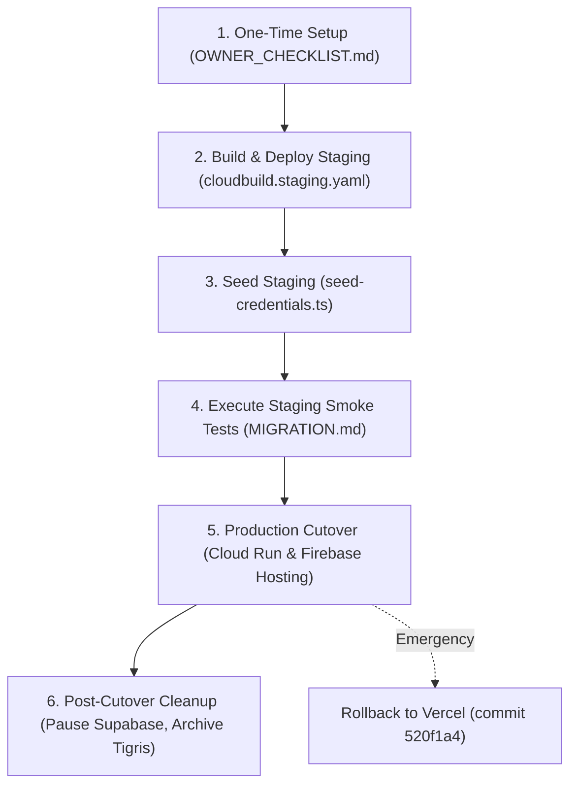

# Childcare Support Phase 3: Google Cloud Migration Index

This directory contains the complete documentation, security audits, architectural specifications, and operational runbooks for migrating **Childcare Support Phase 3** to **Google Cloud Platform (`cs-p3-production`)** in region `asia-south1` (Mumbai).

---

## Master Document Directory

### 1. Operations & Owner Action Runbooks (Primary Reference)
* **[OWNER_CHECKLIST.md](file:///D:/OneDrive%20-%20INDIA%20HIV%20AIDS%20ALLIANCE/Desktop/Software%20Development/Childcare-Main-Verify/docs/gcp-migration/OWNER_CHECKLIST.md)**: **One-Page Copy-Paste PowerShell Runbook**. Contains every command only the Project Owner can run, in chronological order, with expected outputs and failure troubleshooting.
* **[OWNER_QUEUE.md](file:///D:/OneDrive%20-%20INDIA%20HIV%20AIDS%20ALLIANCE/Desktop/Software%20Development/Childcare-Main-Verify/docs/gcp-migration/OWNER_QUEUE.md)**: **"Needs the Owner" Queue**. Action items requiring owner authorization, console setup, or credentials (APIs, IAM, Secret Manager, Cloud Build, Seeding).
* **[MIGRATION.md](file:///D:/OneDrive%20-%20INDIA%20HIV%20AIDS%20ALLIANCE/Desktop/Software%20Development/Childcare-Main-Verify/docs/gcp-migration/MIGRATION.md)**: **Comprehensive Migration Master Guide**. High-level architecture, unified `__session` cookie design, Cloud Run packaging, Firestore TTL policies, staging smoke tests, 100% route inventory (20 static + 7 dynamic + 39 API), and rollback procedures.

### 2. Risk, Security & Financial Audits
* **[RISK_REGISTER.md](file:///D:/OneDrive%20-%20INDIA%20HIV%20AIDS%20ALLIANCE/Desktop/Software%20Development/Childcare-Main-Verify/docs/gcp-migration/RISK_REGISTER.md)**: **Final 9-Point Risk Register**. Detailed risk analysis covering Apps Script execution limits, Nominatim rate limits, India Post taluk gaps, composite indexes, cold starts, read costs, expiring credits, and single-owner dependencies.
* **[SECURITY_AUDIT.md](file:///D:/OneDrive%20-%20INDIA%20HIV%20AIDS%20ALLIANCE/Desktop/Software%20Development/Childcare-Main-Verify/docs/gcp-migration/SECURITY_AUDIT.md)**: **Complete API Security Audit (39 Endpoints)**. Route-by-route authentication, authorization, role scoping, rate limits, PII sanitization review, timing-safe secrets rejection, and GCS path traversal hardening.
* **[COST_ESTIMATE.md](file:///D:/OneDrive%20-%20INDIA%20HIV%20AIDS%20ALLIANCE/Desktop/Software%20Development/Childcare-Main-Verify/docs/gcp-migration/COST_ESTIMATE.md)**: **Monthly Cost Model (INR ₹)**. Read/write pattern analysis for 50 active users/day, Google Cloud Free Tier comparison, and total estimated operating expenditure (₹75 – ₹400 / month).
* **[AUDIT.md](file:///D:/OneDrive%20-%20INDIA%20HIV%20AIDS%20ALLIANCE/Desktop/Software%20Development/Childcare-Main-Verify/docs/gcp-migration/AUDIT.md)**: Initial pre-migration repository and architectural audit.

### 3. Execution History & Progress Tracking
* **[PROGRESS_LOG.md](file:///D:/OneDrive%20-%20INDIA%20HIV%20AIDS%20ALLIANCE/Desktop/Software%20Development/Childcare-Main-Verify/docs/gcp-migration/PROGRESS_LOG.md)**: Autonomous execution log containing timestamps, work items, test counts, build statuses, and commit SHAs.
* **[PHASE_A_REPORT.md](file:///D:/OneDrive%20-%20INDIA%20HIV%20AIDS%20ALLIANCE/Desktop/Software%20Development/Childcare-Main-Verify/docs/gcp-migration/PHASE_A_REPORT.md)**: Phase A completion report (Firestore data layer foundations and environment guards).
* **[PHASE_B_REPORT.md](file:///D:/OneDrive%20-%20INDIA%20HIV%20AIDS%20ALLIANCE/Desktop/Software%20Development/Childcare-Main-Verify/docs/gcp-migration/PHASE_B_REPORT.md)**: Phase B completion report (Authentication, evaluation credentials, leadership OTP, and TTL collections).
* **[PHASE_C_REPORT.md](file:///D:/OneDrive%20-%20INDIA%20HIV%20AIDS%20ALLIANCE/Desktop/Software%20Development/Childcare-Main-Verify/docs/gcp-migration/PHASE_C_REPORT.md)**: Phase C completion report (Cloud Run standalone containerization, health probes, and cron worker).
* **[PHASE_D_REPORT.md](file:///D:/OneDrive%20-%20INDIA%20HIV%20AIDS%20ALLIANCE/Desktop/Software%20Development/Childcare-Main-Verify/docs/gcp-migration/PHASE_D_REPORT.md)**: Phase D completion report (Seed scripts, staging reset, and read-only sheets safety backup).

### 4. Technical Architecture Specifications
* **[TASK2_FIRESTORE_DATA_LAYER.md](file:///D:/OneDrive%20-%20INDIA%20HIV%20AIDS%20ALLIANCE/Desktop/Software%20Development/Childcare-Main-Verify/docs/gcp-migration/TASK2_FIRESTORE_DATA_LAYER.md)**: Technical spec for Firestore adapter and schema mappings.
* **[TASK3_CLOUD_STORAGE.md](file:///D:/OneDrive%20-%20INDIA%20HIV%20AIDS%20ALLIANCE/Desktop/Software%20Development/Childcare-Main-Verify/docs/gcp-migration/TASK3_CLOUD_STORAGE.md)**: Technical spec for GCS keyless signed V4 URLs and CORS policies.
* **[TASK4_CLOUD_RUN.md](file:///D:/OneDrive%20-%20INDIA%20HIV%20AIDS%20ALLIANCE/Desktop/Software%20Development/Childcare-Main-Verify/docs/gcp-migration/TASK4_CLOUD_RUN.md)**: Technical spec for Cloud Run packaging, Secret Manager mapping, and Cloud Scheduler integration.

---

## Quick Navigation: Migration Flow

